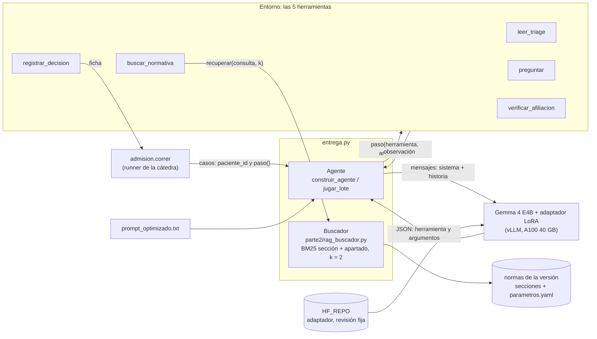

# TP final: el agente de admisión de guardia (grupo)

Agente que completa la ficha de admisión de la guardia del Hospital General de
Prueba con Gemma 4 E4B, un buscador propio sobre las normas y un adaptador LoRA
entrenado por el grupo. El enunciado está en [`mission.md`](mission.md) y el
manual del kit de la cátedra, en [`KIT.md`](KIT.md) (los enlaces de
`mission.md` a `README.md#...` se refieren a ese manual). El desarrollo, parte
por parte, está en [`INFORME.md`](INFORME.md), y los comandos de Modal, en
[`MODAL.md`](MODAL.md).

Todo se sigue con el punto de control publicado en Hugging Face: **no hace
falta entrenar** para verificar nada. Lo que usa GPU corre en Modal, en una
A100 de 40 GB, lanzado desde la terminal local.

Kit descargado de `austral-ing-ai/talksmith-ing` en la revisión de
[`KIT_VERSION.md`](KIT_VERSION.md). `admision/` es la copia oficial sin cambios.

## 1. Entorno

Desde `missions/TPFinal`:

```bash
uv sync                      # el kit, el agente, el entrenamiento y sus dependencias (pyproject.toml + uv.lock)
cp .env.example .env         # completar HF_TOKEN, WANDB_API_KEY y HF_REPO
```

Para lo que corre en Modal hace falta una cuenta con `uv run modal token new` hecho y
el secret `tp-secrets` con las mismas tres variables:

```bash
uv run modal secret create tp-secrets HF_TOKEN=... WANDB_API_KEY=... HF_REPO=...
```

Una sola pila de versiones exactas sirve para evaluar y para entrenar: vLLM
0.34.0 (solo en Linux; en la Mac no se instala), torch 2.14.0, transformers
5.22.2, trl 1.17.1 y peft 0.21.2, entre otras. Las imágenes de Modal se arman
desde el mismo `uv.lock`.

## 2. Un caso

`admision.correr practica` juega y puntúa. Para un solo caso, se copia su línea
a un archivo aparte (el caso `pev-001` activa el circuito de dolor torácico):

```bash
mkdir -p corridas/un-caso
sed -n 1p practica/casos.jsonl > corridas/un-caso/casos.jsonl
uv run python -m admision.correr practica --entrega entrega.py \
    --casos corridas/un-caso/casos.jsonl --esperadas practica/esperadas-b.jsonl \
    --normas normas/b --salida corridas/un-caso/b
```

Necesita GPU: desde la Mac se corre en Modal con los comandos de
[`MODAL.md`](MODAL.md). Qué se ve en `corridas/un-caso/b/`:

- `trazas.jsonl`: la conversación completa con el modelo (cada mensaje que
  entró y cada uno que salió), cada llamada a herramienta con su resultado,
  incluidas las secciones de las normas que trajo `buscar_normativa`, y la
  ficha registrada;
- `resultados.jsonl`: los 9 controles del caso (los 8 campos y la
  verificación de la afiliación) y si quedó resuelto;
- `resumen.json` y `tiempos.json`: casos resueltos, búsquedas, contexto y
  segundos.

## 3. El buscador

```bash
uv run python -m admision.evaluar_rag --entrega entrega.py \
    --normas normas/original --consultas rag/consultas_dev.jsonl
```

`entrega.py` usa el buscador de [`parte2/rag_buscador.py`](parte2/rag_buscador.py).
Sin GPU, la misma evaluación corre con el adaptador de la Parte 2:
`--entrega parte2/entrega_rag.py`. Resultados y experimentos en
[`parte2/RAG.md`](parte2/RAG.md).

## 4. La evaluación completa

Los 50 casos de práctica con las tres versiones de las normas. Para cada
versión `v` en `original`, `b` y `c`:

```bash
uv run python -m admision.correr practica --entrega entrega.py \
    --casos practica/casos.jsonl --esperadas practica/esperadas-$v.jsonl \
    --normas normas/$v --salida corridas/$v
```

`evaluar_todo.sh` y `tabla.py` automatizan las tres corridas y arman la tabla
del informe con sus `resumen.json`; cómo lanzarlos en Modal y bajar los
resultados a `corridas/` está en [`MODAL.md`](MODAL.md).

## 5. De dónde sale cada archivo

| Archivo | Lo genera | Con |
|---|---|---|
| `historial_clasificado.csv`, `costumbres.md`, `curado/auditoria.csv`, `curado/conversaciones_reales.jsonl`, `curado/resumen.json` | `uv run python curar.py` | `historial/`, `normas/original/parametros.yaml` |
| `curado/conversaciones_sinteticas.jsonl`, `curado/sinteticas_config.json`, `curado/sinteticas_resumen.json` | `uv run python generar_sinteticas.py` | semilla 20261108, 600 casos de `admision.generador`, normas original, b y c, buscador de `parte2/` |
| `datos/validacion_politica.json` | `uv run python validar_politica.py` | `practica/` |
| `datos/train.jsonl`, `datos/val.jsonl`, `datos/resumen.json` (prompt + entrenamiento) | `uv run python armar_dataset.py --prompt prompt_optimizado.txt` | semilla 20261117; historial correcto, `entrenamiento/trazas.jsonl` y sintéticas |
| `datos/sin_prompt/` (solo entrenamiento, prompt de `admision/ejemplo.py`) | `uv run python armar_dataset.py --salida datos/sin_prompt` | lo mismo |
| `prompt_optimizado.txt`, `config_optimizado.yaml` | candidato 9 de `optimizar_prompt.py` (GEPA, `corridas/gepa/gepa1/log.jsonl`) | ver `INFORME.md`, Parte 3, y `MODAL.md`, sección 7 |
| `corridas/<etiqueta>/`, `corridas/tabla.md` (evaluaciones de la Parte 3) | `modal_app.py::evaluar` y `uv run python tabla.py` | el yaml de `--config` (`config.yaml`, `config_corto.yaml`, `config_optimizado.yaml`) |
| Cada entrenamiento: adaptador en `HF_REPO` (etiquetas `<corrida>-paso-<N>`, `<corrida>-final` y `final`), corrida en W&B y `corridas/<corrida>/` | `uv run modal run --detach modal_entrenar.py --corrida <corrida>` (corre `entrenar.py`) | `entrenar.yaml` (semilla 20261117) y el archivo de datos, cuyo sha256 queda en W&B y en `corrida.json` del repo de HF |
| `corridas/<version>/` (trazas, resultados y resumen de la evaluación) | `admision.correr` (sección 4) | `entrega.py` con `config.yaml` (o el yaml de `CONFIG`): prompt, adaptador y su revisión |
| `revision_parte1.md` (cifras) | `uv run python revisar_parte1.py` | `historial/`, `curado/auditoria.csv` |

Los comandos de Modal (lanzar, ver logs, bajar resultados y retomar) para la
evaluación, la optimización de prompt y el entrenamiento están en
[`MODAL.md`](MODAL.md), en el orden en que se corren.

Hoy `config.yaml` usa `prompt_base.txt` y ningún adaptador (el modelo sin
entrenar); el diagrama de la sección 6 muestra la entrega final, con
`prompt_optimizado.txt` y el adaptador de `HF_REPO`, que se fijan en
`config.yaml` cuando esté entrenado.

## 6. Cómo se conecta el agente



## Partes 1 y 2 en una línea

- **Parte 1:** `curar.py` clasifica el historial (1.600 correctas, 240 errores,
  160 ruido) y documenta dos costumbres: el aviso al voluntariado para
  pacientes de 75 años o más sin acompañante y la prepaga cuando se presentan
  dos credenciales. Los desvíos de ambas son de tres operadores que hacen las
  cosas a su manera ([`revision_parte1.md`](revision_parte1.md)).
- **Parte 2:** el buscador da recall 1,000, precisión 0,567, 590 tokens por
  consulta y 60 de 60 consultas completas en `rag/consultas_dev.jsonl`, contra
  0,875, 0,492, 580 y 51 de 60 de la referencia BM25 de la cátedra.
